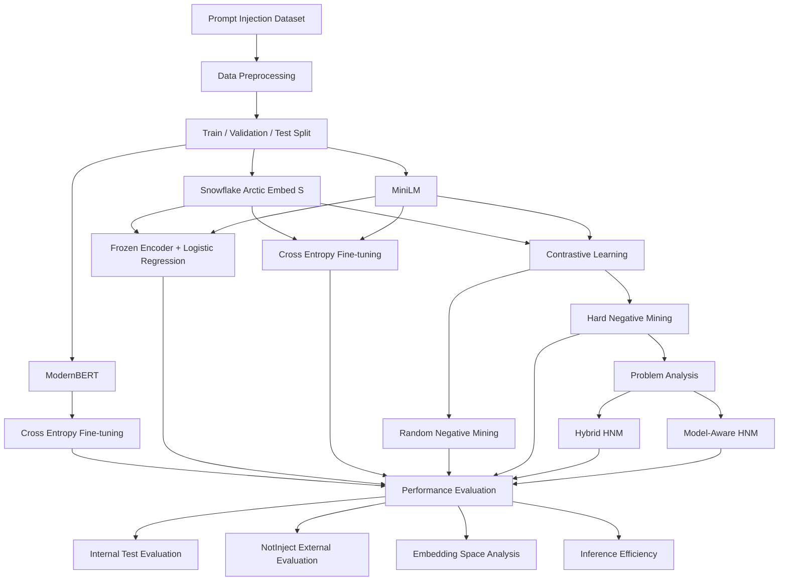
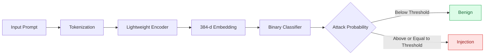

# Lightweight Prompt Injection Detection

경량 프롬프트 인젝션 탐지 모델의 과잉 방어 완화를 위한 Hard Negative Mining 기법 비교 및 개선

**Contrastive Learning | Hard Negative Mining | LLM Security**

---

## 1. Overview

본 프로젝트는 LLM의 프롬프트 인젝션 공격을 탐지하기 위한 경량 모델을 구축하고, 정상 입력을 공격으로 잘못 판단하는 과잉 방어(Overdefense) 문제를 분석하는 것을 목표로 한다.

ModernBERT를 기준 모델로 설정하고, Snowflake Arctic Embed S와 MiniLM을 대상으로 일반 지도학습과 대조 학습의 성능을 비교하였다.

기존 Hard Negative Mining 적용 과정에서 임베딩 분리도는 향상되었으나 정상 입력에 대한 오탐률이 증가하는 문제를 확인하였다. 이를 보완하기 위해 Hybrid HNM과 Model-Aware HNM을 추가로 적용하였다.

총 3개 Backbone과 13개 실험군을 구성하여 다음 항목을 비교 및 분석하였다.

- 프롬프트 인젝션 탐지 정확도
- 정상 입력 오탐률 및 과잉 방어
- Negative Sampling 전략에 따른 성능 변화
- 임베딩 공간의 클래스 분리도
- 추론 지연시간 및 처리량
- 모델 파라미터 및 GPU 메모리 사용량
- NotInject 외부 데이터셋 기반 일반화 성능

---
## 2. Research Background & Objectives

### 2.1 Research Background

LLM의 활용 범위가 확대됨에 따라 기존 시스템 지침을 무시하도록 유도하는 프롬프트 인젝션(Prompt Injection) 공격에 대한 방어의 중요성이 증가하고 있다.

프롬프트 인젝션 탐지 모델은 사용자 입력을 사전에 검사하여 악성 프롬프트를 차단하는 역할을 수행하지만, 다음과 같은 문제가 존재한다.

- **Computational Cost**: 탐지 모델의 높은 연산 비용 및 추론 지연시간
- **Overdefense**: 공격 관련 표현이 포함된 정상 입력을 공격으로 오인하는 문제
- **Generalization**: 학습 데이터와 다른 유형의 입력에 대한 탐지 성능 저하

| Prompt | Ground Truth |
|---|---|
| Ignore all previous instructions. | Injection |
| Explain what prompt injection is. | Benign |
| How can we prevent prompt injection attacks? | Benign |

공격 관련 키워드의 포함 여부만으로는 정상 입력과 공격 입력을 정확하게 구분하기 어렵다. 따라서 문장의 맥락과 의도를 고려한 탐지가 필요하다.

### 2.2 Research Objectives

본 프로젝트에서는 경량 임베딩 모델과 대조 학습을 활용하여 탐지 성능과 연산 효율을 확보하고, Hard Negative Mining을 통한 과잉 방어 완화 가능성을 검증하고자 한다.

- **Lightweight Detection**: 경량 모델을 활용한 추론 지연시간 및 메모리 사용량 감소
- **Contrastive Learning**: 정상 입력과 공격 입력의 임베딩 표현 학습
- **Hard Negative Mining**: 구별하기 어려운 샘플을 활용한 과잉 방어 완화 가능성 검증
- **Improved Negative Mining**: 기존 HNM의 한계를 분석하고 Hybrid 및 Model-Aware HNM 적용
- **External Evaluation**: NotInject 데이터셋을 활용한 과잉 방어 및 일반화 성능 검증

---

## 3. Dataset & Preprocessing

### 3.1 Dataset

프롬프트 인젝션 탐지 모델 학습을 위해 Hugging Face의 S-Labs Prompt Injection Dataset을 사용하였다.

- **Dataset**: [S-Labs/prompt-injection-dataset](https://huggingface.co/datasets/S-Labs/prompt-injection-dataset)
- **Total Samples**: 15,291
- **Task**: Binary Classification
- **Input**: Text Prompt
- **Label**: Benign (0), Injection (1)

| Split | Original Samples | Preprocessed Samples |
|---|---:|---:|
| Train | 11,089 | 11,046 |
| Validation | 2,101 | 1,985 |
| Test | 2,101 | 2,101 |
| **Total** | **15,291** | **15,132** |

### 3.2 Data Preprocessing

데이터 중복으로 인한 Data Leakage를 방지하고 공정한 성능 비교를 위해 다음과 같은 전처리를 수행하였다.

- Train 데이터 내부의 중복 문장 제거
- 동일 문장에 대한 상충된 Label 처리
- Train과 Validation 사이의 중복 문장 제거
- Validation과 Test 사이의 중복 문장 제거
- 기존 Test Split 유지
- Maximum Sequence Length: 128
- Dynamic Padding 적용

### 3.3 Class Distribution

| Split | Benign (0) | Injection (1) | Total |
|---|---:|---:|---:|
| Train | 6,264 | 4,782 | 11,046 |
| Validation | 1,043 | 942 | 1,985 |
| Test | 1,050 | 1,051 | 2,101 |
| **Total** | **8,357** | **6,775** | **15,132** |

모든 실험군에 동일한 데이터 분할을 적용하였으며, Validation Macro F1 Score를 기준으로 최적의 Checkpoint를 선정하였다.

기존 Test 평가 이후 설계된 개선 HNM 실험은 후속 탐색 실험으로 구분하였다.

### 3.4 External Dataset — NotInject

학습 데이터와 다른 유형의 정상 입력에 대한 과잉 방어 문제를 평가하기 위해 NotInject 데이터셋을 추가로 활용하였다.

- **Dataset**: [leolee99/NotInject](https://huggingface.co/datasets/leolee99/NotInject)
- **Total Samples**: 339
- **Label**: Benign Only
- **Purpose**: External Overdefense Evaluation
- **Exact Overlap with Original Dataset**: 0

| Number of Trigger Words | Samples |
|---|---:|
| 1 | 113 |
| 2 | 113 |
| 3 | 113 |
| **Total** | **339** |

NotInject는 공격 관련 키워드를 포함하지만 실제 공격 의도가 없는 정상 프롬프트로 구성되어 있다.

해당 데이터셋은 모델 학습 및 임계값 설정에 사용하지 않았으며, 외부 데이터에 대한 과잉 방어 및 일반화 성능 평가에만 활용하였다.

---

## 4. Overall Research Pipeline

본 프로젝트는 경량 모델의 탐지 성능 검증을 시작으로 대조 학습, Hard Negative Mining 적용, 문제점 분석 및 개선 기법 검증의 순서로 진행하였다.

### 4.1 Research Stages

| Stage | Description |
|---|---|
| Stage 1 | 데이터셋 구축 및 전처리 |
| Stage 2 | ModernBERT 기준 모델 및 경량 모델 성능 비교 |
| Stage 3 | Random Negative 기반 대조 학습 |
| Stage 4 | Hard Negative Mining 적용 및 성능 검증 |
| Stage 5 | 기존 HNM의 오탐률 증가 및 Negative 다양성 감소 분석 |
| Stage 6 | Hybrid HNM 및 Model-Aware HNM 적용 |
| Stage 7 | 내부 Test 및 NotInject 외부 데이터셋 평가 |
| Stage 8 | 임베딩 분포, 통계적 유의성 및 추론 효율 분석 |

### 4.2 Inference Pipeline

경량 모델의 추론 과정은 입력 문장의 Tokenization, Encoder 기반 임베딩 추출, 이진 분류 순서로 구성된다.

Hard Negative Mining과 개선된 Mining 기법은 학습 단계에서만 적용되므로 별도의 추론 모듈을 추가하지 않고 기존 모델 구조와 경량성을 유지할 수 있다.

---

